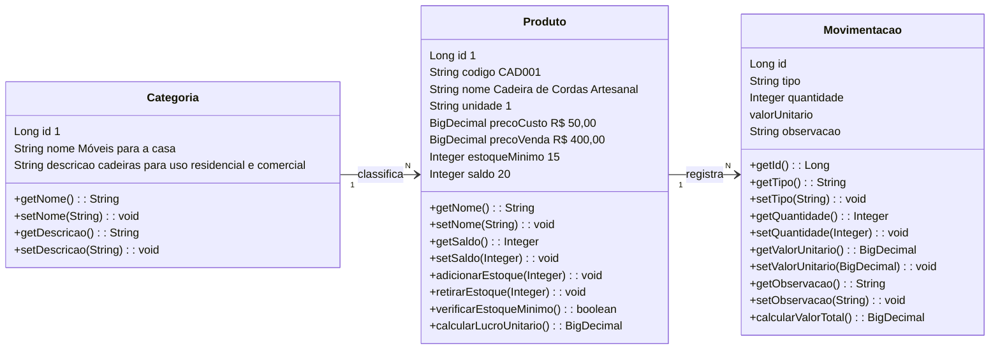

# Mestre artesão vendas

> Substitua o título acima pelo nome do seu sistema e preencha cada seção deste documento.
> Este README é o **documento de visão** do projeto (entrega **AVA 1**) e, ao longo do curso,
> também será o manual técnico de como executar o sistema.

| | |
|---|---|
| **Aluno(a)** | Gabriel Henrique Caetano Geremias|
| **Turma** |TEC-N-001788/2026 |
| **Opção escolhida** |controle de estoque|
| **Versão atual** | 0.1.0 |

---

## 1. Visão geral
- Cadastro e entrada de produtos:
O administrador ou estoquista cadastra os produtos e registra as mercadorias recebidas, aumentando automaticamente o estoque.

- Registro das vendas:
O vendedor seleciona os produtos e as quantidades. O sistema calcula o total, registra o pagamento e reduz as quantidades disponíveis no estoque.

- Alertas de estoque:
Quando um produto atinge a quantidade mínima definida, o sistema alerta o responsável para providenciar a reposição.

- Painel de indicadores e relatórios:
O administrador acompanha o faturamento, os produtos mais vendidos, os níveis de estoque e o desempenho das vendas.


### 1.1 Problema
<!-- Que problema o sistema resolve? Quem sofre com esse problema hoje e como ele é resolvido (planilha, papel, WhatsApp...)? 3 a 5 linhas. -->
O gerenciamento do estoque é realizado de forma manual, dificultando o monitoramento das vendas. Alguns produtos se esgotam sem alertas prévios, há inconsistências nos registros de quantidades e torna-se complicado identificar os itens com maior saída e calcular o faturamento.

### 1.2 Canvas do projeto

| Bloco | Resposta |
|---|---|
| **Usuários** (quem usa o sistema) |Vendedor (registra vendas e consulta produtos), estoquista (gerencia produtos e reposição) e administrador (gerencia cadastros, relatórios e indicadores). |
| **Problema** (dor atual) |O estoque é controlado manualmente, há dificuldade para acompanhar as vendas, produtos acabam sem aviso, ocorrem divergências nas quantidades e existe dificuldade para identificar os produtos mais vendidos e o faturamento. |
| **Proposta de valor** (o que melhora com o sistema) |Controlar o estoque em tempo real, registrar vendas rapidamente e acompanhar entradas, saídas, faturamento e produtos com baixo estoque em um único sistema. |
| **Funcionalidades principais** |Cadastro de produtos e categorias; cadastro de fornecedores; entrada e saída de mercadorias; registro de vendas; cálculo automático do valor total e do troco; atualização automática do estoque após cada venda; controle de preços e descontos; consulta ao histórico de vendas; alertas de estoque mínimo; cancelamento e estorno de vendas; cadastro e login de usuários; painel de indicadores; geração de relatórios de vendas e estoque. |
| **Informações que o sistema guarda** |Produtos: código, nome, descrição, categoria, preço de custo, preço de venda, quantidade em estoque e estoque mínimo. Vendas: número da venda, data, vendedor, produtos vendidos, quantidades, descontos, valor total e forma de pagamento. Fornecedores: nome, CNPJ/CPF, telefone e e-mail. Movimentações: produto, tipo de movimentação, quantidade, data e responsável. Usuários: nome, login, senha protegida e perfil de acesso. |
| **Indicadores** (o que o gestor quer acompanhar) |Total de vendas por dia, semana e mês; faturamento total; quantidade de produtos vendidos; produtos mais vendidos; produtos com estoque baixo ou zerado; valor estimado do estoque; margem de lucro; ticket médio; vendas por vendedor; entradas e saídas de mercadorias; produtos com pouca saída e histórico de vendas canceladas. |
| **Restrições** (prazo, tecnologia, equipe) | Projeto individual · Java 21 · Spring Boot 4 · entrega v1.0 em 11/11 |

---

## 2. Requisitos
O sistema de Controle de Estoque e Vendas tem como objetivo facilitar o gerenciamento de produtos, o registro de vendas, o controle de entradas e saídas de mercadorias e o acompanhamento dos resultados comerciais.

### 2.1 Requisitos funcionais (o que o sistema FAZ)

| ID | Requisito | Nível |
|---|---|---|
| RF01 | O sistema deve permitir cadastrar, consultar e editar produtos, incluindo nome, código, preço e quantidade em estoque. | Essencial |
| RF02 |O sistema deve permitir registrar vendas, selecionando produtos, quantidades e formas de pagamento. | Essencial |
| RF03 |O sistema deve atualizar automaticamente o estoque após a entrada ou saída de mercadorias. | Essencial |
| RF04 |O sistema deve permitir consultar os produtos disponíveis e identificar aqueles com estoque baixo.| Essencial |
| RF05 |O sistema deve gerar relatórios com faturamento, quantidade de vendas e produtos mais vendidos.| Importante |

### 2.2 Requisitos não funcionais (COMO o sistema deve ser)

| ID | Requisito |
|---|---|
| RNF01 | O sistema deve ser acessado pelo navegador (aplicação web). |
| RNF02 | O sistema deve exigir login e senha; as senhas devem ser armazenadas criptografadas. |
| RNF03 | O sistema deve proteger os dados e armazenar as senhas de forma segura. |
| RNF04 | O sistema deve possuir uma interface simples, intuitiva e fácil de utilizar.
| RNF05 | O sistema deve permitir a realização de cópias de segurança para evitar a perda de informações.
| RNF06 | O sistema deve processar consultas e registros de vendas rapidamente em condições normais de uso.
| RNF07 | O sistema deve garantir que as informações de vendas e estoque sejam registradas corretamente.

### 2.3 Regras de negócio (as REGRAS do negócio que o sistema precisa respeitar)

| ID | Regra |
|---|---|
| RN01 | Cada produto deve possuir um código exclusivo para evitar duplicidade de cadastro. |
| RN02 | O sistema não deve permitir vendas em quantidades superiores ao estoque disponível. |
| RN03 | Após a confirmação de uma venda, a quantidade dos produtos vendidos deve ser descontada do estoque. |
| RN04 | Os preços dos produtos não podem ser negativos, e o valor total da venda deve ser calculado automaticamente.
| RN05 | Ao cancelar uma venda, o sistema deve registrar o cancelamento e devolver os produtos ao estoque, quando aplicável.

---

# 3. Histórias de usuário

Formato: **Como** *[papel]*, **quero** *[ação]*, **para** *[benefício]*.

### HU01 — Cadastro de produtos

Como responsável pelo estoque, quero cadastrar produtos, para manter o controle das cadeiras disponíveis para venda.

- Critério de aceitação: o sistema deve permitir cadastrar produtos com nome, código, categoria, preço de custo, preço de venda e quantidade em estoque.
- Critério de aceitação: o sistema não deve permitir o cadastro de produtos com códigos duplicados.

### HU02 — Registro de vendas

Como vendedor, quero registrar a venda de cadeiras, para controlar as saídas do estoque e acompanhar as vendas realizadas.

- Critério de aceitação: somente produtos com quantidade disponível em estoque podem ser vendidos.
- Critério de aceitação: a quantidade vendida não pode ser maior que a quantidade disponível.
- Critério de aceitação: o sistema deve calcular automaticamente o valor total da venda.
- Critério de aceitação: após confirmar a venda, o sistema deve atualizar automaticamente o estoque.

### HU03 — Controle de entrada e saída

Como responsável pelo estoque, quero registrar as entradas e saídas de cadeiras, para manter as quantidades disponíveis sempre atualizadas.

- Critério de aceitação: o sistema deve registrar o tipo de movimentação, a quantidade, o valor unitário e a data.
- Critério de aceitação: o sistema não deve permitir saídas em quantidades superiores ao estoque disponível.
- Critério de aceitação: toda movimentação deve ficar registrada no histórico do produto.

### HU04 — Consulta de estoque

Como responsável pelo estoque, quero consultar as cadeiras disponíveis, para identificar os produtos que precisam de reposição.

- Critério de aceitação: o sistema deve exibir o nome, o código e a quantidade disponível de cada produto.
- Critério de aceitação: o sistema deve alertar quando um produto atingir ou ficar abaixo da quantidade mínima definida.

### HU05 — Relatórios de vendas

Como proprietário da loja, quero consultar relatórios de vendas, para acompanhar o faturamento e identificar as cadeiras mais vendidas.

- Critério de aceitação: o sistema deve apresentar o total de vendas por período.
- Critério de aceitação: o sistema deve exibir os produtos mais vendidos e suas respectivas quantidades.
- Critério de aceitação: o sistema deve permitir consultar o histórico de vendas por data.

### HU06 — Controle de preços

Como administrador, quero cadastrar e atualizar os preços de custo e de venda das cadeiras, para manter os valores dos produtos corretos.

- Critério de aceitação: o sistema deve permitir alterar os preços dos produtos cadastrados.
- Critério de aceitação: o sistema não deve aceitar preços negativos.
- Critério de aceitação: o sistema deve utilizar o preço de venda vigente no momento do registro da venda.

### HU07 — Histórico de movimentações

Como responsável pelo estoque, quero consultar o histórico de movimentações das cadeiras, para acompanhar todas as entradas e saídas realizadas.

- Critério de aceitação: o sistema deve registrar a data, o tipo de movimentação e a quantidade movimentada.
- Critério de aceitação: o sistema deve permitir identificar se a movimentação foi uma entrada, uma venda ou outra saída.
- Critério de aceitação: o sistema deve permitir consultar as movimentações de um produto específico.

---

## 4. Modelo de dados



---

## 5. Como executar

### No GitHub Codespaces (recomendado)
1. No repositório, clique em **Code → Codespaces → Create codespace on main** (ou abra o Codespace existente).
2. Aguarde a preparação do ambiente.
3. No terminal, execute:
   ```bash
   mvn spring-boot:run
   ```
4. Quando aparecer o aviso da porta **8080**, clique em **Abrir no navegador**.

### No computador (ferramentas instaladas)
Requisitos: JDK 21 e uma IDE (IntelliJ IDEA ou VS Code com o *Extension Pack for Java*).
Abra o projeto na IDE e execute a classe `SistemaApplication`. Acesse `http://localhost:8080`.

### Acesso
| Usuário | Senha | Perfil |
|---|---|---|
| admin | admin123 | Administrador |
| operador | operador123 | Operador |

*(o login passa a ser exigido a partir do Encontro 7)*

---

## 6. Tecnologias
Java 21 · Spring Boot 4 · Spring MVC · Thymeleaf · Bootstrap 5 · Spring Data JPA · H2 (desenvolvimento) · MySQL (produção) · Spring Security · Git/GitHub

## 7. Uso de inteligência artificial
<!-- Registre aqui, de forma resumida, quando e como você usou ferramentas de IA de forma relevante no projeto. -->

## 8. Histórico de versões
| Versão | Data | Descrição |
|---|---|---|
| 0.1.0 | | Projeto inicial criado a partir do repositório modelo |

## Usuários de teste

| Usuário | Senha | Perfil | O que pode fazer |
|---|---|---|---|
| admin | admin123 | Administrador | Tudo |
| operador | operador123 | Operador | Consulta produtos e categorias e registra movimentações |